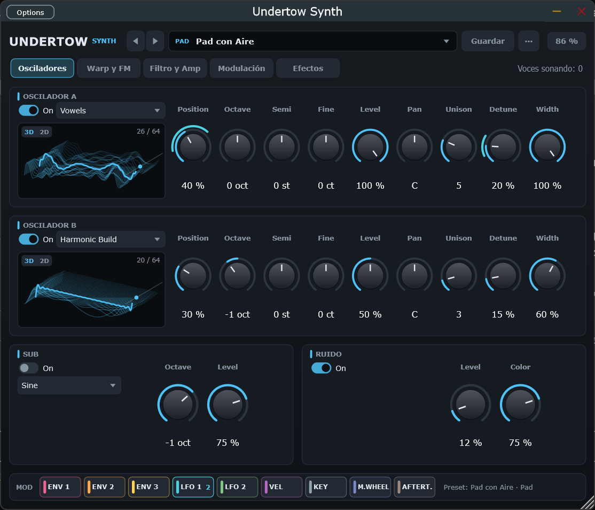
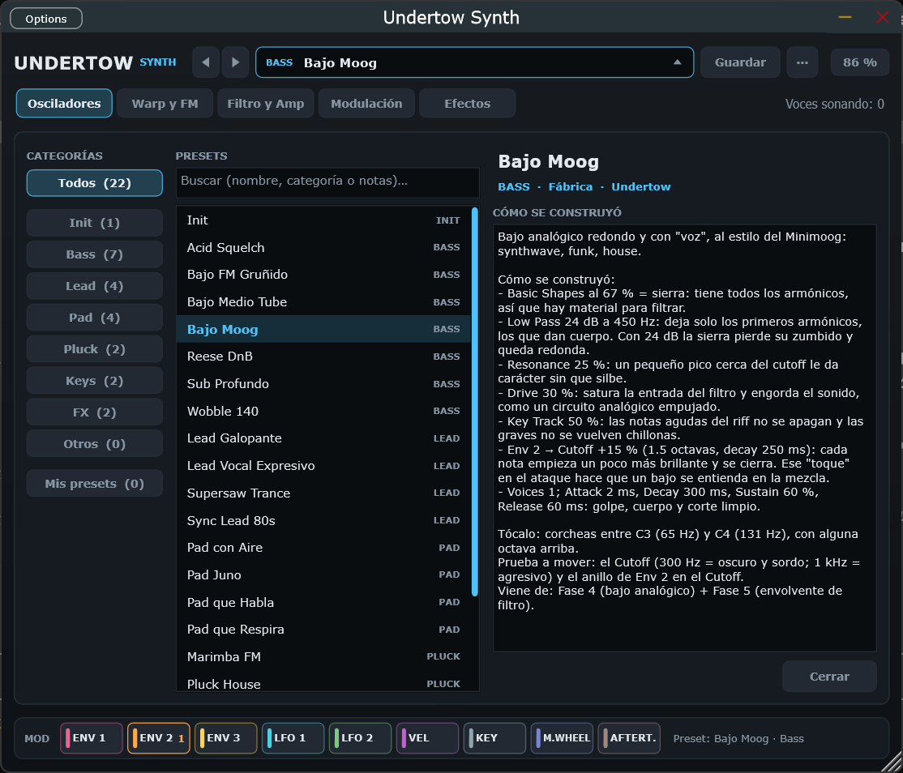
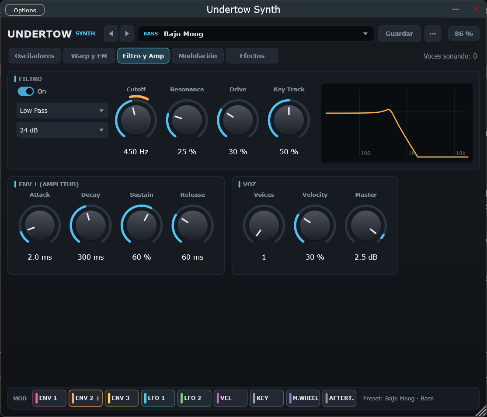
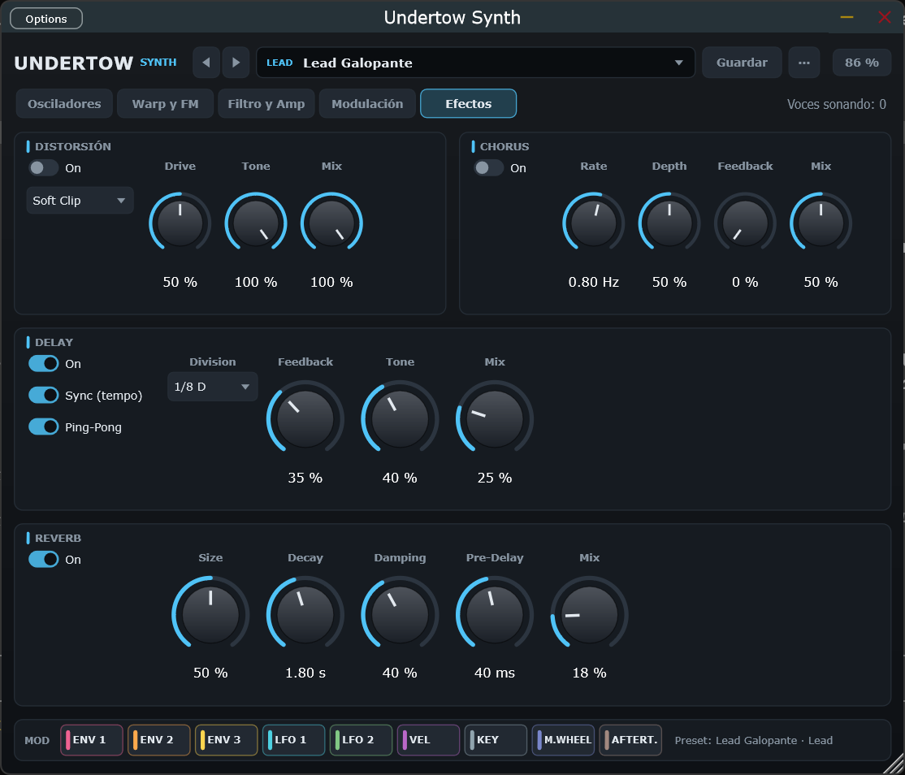

# Undertow Synth

Sintetizador **wavetable polifónico** en formato VST3 y Standalone para Windows, escrito en C++20 con JUCE.
Es un proyecto de aprendizaje de programación de audio y diseño sonoro, construido por fases, con la meta de
llegar al nivel de sintes como Serum o Vital.



> **Estado:** en desarrollo (fases 1–10 de 11 completadas). Ya suena y es usable en un DAW: tiene efectos, una interfaz
> escalable con modulación por arrastre y una librería de 22 presets que explican cómo se construyó cada sonido. Falta
> la fase de optimización y pulido. Ver la [hoja de ruta](#hoja-de-ruta).

## Qué tiene hoy

- **Dos osciladores wavetable sin aliasing (A y B):** mipmaps por octava, interpolación cúbica y morphing continuo
  entre frames. Tiene 5 tablas de fábrica: *Basic Shapes*, *Pulse Width*, *Harmonic Build*, *Hard Sync* y *Vowels*.
- **Unison de hasta 16 copias por oscilador,** con detune, ancho estéreo y paneo. El volumen se mantiene al cambiar
  el número de copias y ninguna copia produce aliasing.
- **Warp, FM y ring mod en cada oscilador:** Sync, Bend + / −, PWM, Mirror, Quantize y Bitcrush; FM (en realidad PM,
  como el DX7) y ring mod desde el otro oscilador, el sub o el ruido. Con control de aliasing: mipmap según la velocidad
  real de lectura, polyBLEP/polyBLAMP de 4 muestras y oversampling ×2 con decimador halfband.
- **Sub-oscilador** (seno, triángulo, sierra o cuadrada, de 0 a −3 octavas) y **ruido** con control de color.
- **Filtro ZDF/TPT:** Low Pass, High Pass y Band Pass de 12 o 24 dB/octava, con resonancia, drive y key tracking.
  Incluye un visor de la curva de respuesta.
- **Modulación:** 2 envolventes extra (Env 2 y Env 3), 2 LFOs (6 formas, sincronizables al tempo, modos Free,
  Retrigger y One Shot) y una matriz de 8 rutas. Fuentes: envolventes, LFOs, velocity, nota, rueda de modulación y
  aftertouch. Destinos: posición, tono, nivel, detune, warp y FM/RM de cada oscilador, tono global, nivel del sub y
  del ruido, cutoff, resonancia, drive y volumen.
- **Efectos globales:** distorsión (Soft Clip, Hard Clip, Tube y Fold, con oversampling ×4 y ADAA), chorus estéreo,
  delay estéreo o ping-pong (libre o sincronizado al tempo) y reverb algorítmica (red de 8 retardos realimentados).
- **Polifonía de 1 a 16 voces** con robo de voces sin clics, pedal de sustain (CC64) y CC120/123.
- **Envolvente ADSR** exponencial y sensibilidad a la velocity.
- **MIDI y host:** rueda de modulación (CC1) y aftertouch como fuentes de modulación; tempo y posición de la canción
  del DAW para los LFOs y el delay sincronizados. Informa al DAW de la cola (release, reverb y delay) para que no se
  corte al exportar.
- **Interfaz escalable en 5 pestañas** (Osciladores, Warp y FM, Filtro y Amp, Modulación, Efectos), dibujada con
  vectores: zoom de 70 a 200 % nítido a cualquier tamaño, recordado en el proyecto.
- **Arrastrar para modular:** las fuentes de modulación se sueltan sobre las perillas. Cada ruta se dibuja como un
  anillo del color de su fuente y un punto muestra el valor modulado en vivo.
- **Visor 3D del wavetable** con todos los frames apilados y el frame que suena, con el warp aplicado y la modulación
  en vivo (o en 2D: original y deformada). Visores de la curva del filtro y de los LFOs.
- **Presets:** navegador con categorías y búsqueda, guardar tus propios sonidos (con notas) y **22 presets de fábrica**
  (bajos, leads, pads, plucks, keys y FX) con el volumen igualado. Cada uno trae notas que explican cómo se construyó y
  qué perilla probar: la librería es también material de estudio. El proyecto del DAW recuerda qué preset cargaste y si
  lo modificaste.
- Correcto a 44.1, 48, 88.2 y 96 kHz y con cualquier tamaño de buffer, en estéreo o mono. Validado con
  [pluginval](https://github.com/Tracktion/pluginval) en strictness 10.

### Cómo fluye la señal

```
 por cada nota (hasta 16 voces)                                           una vez, sobre la suma
┌─────────────────────────────────────────────────────────────────┐   ┌──────────────────────────────┐
│ Osc A ─┐  (unison, warp, FM/RM)                                 │   │                              │
│ Osc B ─┼─► mezcla ─► filtro ─► amplitud (Env 1) ────────────────┼──►│ distorsión ─► chorus ─►      │──► Master
│ Sub   ─┤                                                        │   │ delay ─► reverb              │
│ Ruido ─┘   ▲ Env 2, Env 3, LFO 1, LFO 2, velocity, nota,        │   └──────────────────────────────┘
│            │ rueda de modulación y aftertouch vía la matriz     │
└─────────────────────────────────────────────────────────────────┘
```

## Requisitos

- Windows 10/11 de 64 bits.
- [Visual Studio 2022](https://visualstudio.microsoft.com/es/vs/community/) (Community sirve), con el workload
  **"Desarrollo para el escritorio con C++"**.
- [CMake](https://cmake.org/download/) 3.22 o superior.
- Git. JUCE 9.0.2 se descarga solo durante la configuración (no hace falta instalarlo).

No hay binarios publicados todavía: hay que compilarlo (son 3 comandos).

## Compilar

```bash
git clone https://github.com/EduardoCamposCasillas/undertow-synth.git
cd undertow-synth
cmake -B build -G "Visual Studio 17 2022" -A x64
cmake --build build --config Release
```

La primera configuración tarda unos minutos porque descarga JUCE. Al terminar tendrás:

| Formato | Ruta |
|---|---|
| VST3 | `build/UndertowSynth_artefacts/Release/VST3/Undertow Synth.vst3` |
| Standalone | `build/UndertowSynth_artefacts/Release/Standalone/Undertow Synth.exe` |

Si `cmake` no se reconoce, usa la ruta completa (`"C:\Program Files\CMake\bin\cmake.exe"`) o agrégalo al PATH.

### Tests

```bash
ctest --test-dir build -C Release --output-on-failure
```

Hay dos ejecutables de tests:

- `UndertowTests` (`tests/DspTests.cpp`, sin JUCE) mide afinación, aliasing, respuesta del filtro, ausencia de clics,
  tiempos de los ecos y de la reverb, y coste de CPU, a las 4 frecuencias de muestreo.
- `UndertowPresetTests` (`tests/PresetTests.cpp`, con JUCE) valida cada preset de fábrica, guardar y cargar, el estado
  del proyecto, y renderiza los 22 presets para comprobar que no hay NaN ni picos y que los volúmenes están igualados.

Opciones para iterar más rápido:

```bash
build/Release/UndertowTests.exe --fase8     # solo los tests de efectos (--fase7: warp y FM; --fase9: interfaz)
build/Release/UndertowTests.exe --verbose   # detalle de cada medición

build/UndertowPresetTests_artefacts/Release/UndertowPresetTests.exe --verbose               # nivel de cada preset
build/UndertowPresetTests_artefacts/Release/UndertowPresetTests.exe --verbose --user "ruta"  # mide también tus presets
build/UndertowPresetTests_artefacts/Release/UndertowPresetTests.exe --notes                 # notas de los presets
```

## Usarlo

### Standalone (la forma más rápida de probarlo)

1. Abre `Undertow Synth.exe`.
2. En **Options → Audio/MIDI Settings** elige tu tarjeta de sonido y activa tu teclado MIDI.
3. Toca. Sin teclado MIDI, lo más cómodo es usarlo dentro de un DAW.

### En FL Studio

1. Copia la carpeta `Undertow Synth.vst3` a `C:\Program Files\Common Files\VST3` (requiere administrador).
   También puedes agregar `build/UndertowSynth_artefacts/Release/VST3` como carpeta de búsqueda.
2. **Options → Manage plugins**. Si agregaste una carpeta propia, márcala como tipo **VST3**: si queda como VST2,
   FL no encuentra el plugin. Pulsa **Find installed plugins**.
3. En el Channel Rack: **+ → Undertow Synth**.

En otros DAWs (Ableton, Reaper, Bitwig…) funciona igual: hay que reescanear la carpeta VST3.

### La interfaz

- **Presets:** la barra de arriba muestra la categoría y el nombre del preset (con `*` si lo modificaste). **◀ ▶**
  recorren la librería; clic en el nombre abre el **navegador**: categorías, búsqueda (también en las notas) y las
  notas de cómo se construyó cada sonido. Un clic en la lista (o las flechas del teclado) carga el preset para
  escucharlo; doble clic o Enter lo carga y cierra el navegador. **Guardar** pide nombre, categoría, autor y notas; el
  menú **···** tiene *Init* (empezar desde cero) y abre tu carpeta de presets.
- **Zoom:** botón con el porcentaje (arriba a la derecha) o arrastrando la esquina inferior derecha. La primera vez
  elige el mayor tamaño que cabe en tu pantalla; después recuerda el último que uses.
- **Perillas:** arrastra arriba/abajo para moverlas; doble clic = valor por defecto; clic derecho = rutas de
  modulación y opciones del DAW (en FL, *Create automation clip*).
- **Arrastrar para modular:** arrastra una ficha de la barra **MOD** (Env 1–3, LFO 1–2, Velocity, Key, Mod Wheel,
  Aftertouch) sobre una perilla. Se crea una ruta de la matriz con amount 25 %. Si pasas por encima de una pestaña
  mientras arrastras, se abre sola.
  - El **anillo de color** es el tramo que recorre la modulación. Arrástralo para cambiar el amount (Shift = fino).
    Las fuentes unipolares (envolventes, velocity, controladores) lo abren hacia un lado; las bipolares (LFOs, Key),
    hacia los dos.
  - El **punto blanco** es el valor real del destino en la nota más reciente.
  - Aceptan modulación: Position, Semi (pitch), Level y Detune de cada oscilador, Warp y FM/RM Amount, Level del sub
    y del ruido, y Cutoff, Resonance y Drive del filtro. *Volume* y *Global Pitch* se conectan desde la matriz.
- **Visor del wavetable:** arrastra sobre él para mover Position; clic en **3D / 2D** para cambiar la vista.



Tus presets se guardan en `Documentos\Undertow\Presets` como archivos `.uwpreset` (XML legible, con los valores en
Hz, ms y %). Puedes organizarlos en subcarpetas, copiarlos o compartirlos. Los de fábrica viven dentro del plugin y
están en [`Presets/Factory`](Presets/Factory): cada archivo solo escribe lo que cambia respecto a *Init*, así que se
lee como una receta.

| Categoría | Presets |
|---|---|
| Init | Init |
| Bass | Sub Profundo, Bajo Moog, Acid Squelch, Wobble 140, Reese DnB, Bajo FM Gruñido, Bajo Medio Tube |
| Lead | Supersaw Trance, Sync Lead 80s, Lead Galopante, Lead Vocal Expresivo |
| Pad | Pad que Habla, Pad Juno, Pad con Aire, Pad que Respira |
| Pluck | Pluck House, Marimba FM |
| Keys | Campana FM, E-Piano FM |
| FX | Riser de Ruido, Lluvia S&H |



### Controles

**Pestaña Osciladores: Oscilador A y Oscilador B** (B viene apagado)
| Control | Qué hace |
|---|---|
| On | Enciende o apaga el oscilador (con un fundido corto: sin clics). |
| Wavetable | Elige la familia de timbres. Cambiarla con notas sonando no produce clics. |
| Position | Recorre los frames de la tabla. En *Basic Shapes*: 0 % seno, 33 % triángulo, 67 % sierra y 100 % cuadrada. |
| Octave / Semi / Fine | Afinación: ±4 octavas, ±12 semitonos y ±100 cents. |
| Level / Pan | Volumen del oscilador y posición en el estéreo. |
| Unison | Cuántas copias de la onda suenan a la vez (1 a 16). |
| Detune | Cuánto se desafinan las copias entre sí (hasta ±1 semitono). Poco = coro suave; mucho = supersaw. |
| Width | Cuánto se abren las copias hacia izquierda y derecha. |

**Sub y Ruido**
| Control | Qué hace |
|---|---|
| Sub: forma, Octave, Level | Un oscilador simple por debajo de la nota (mono, siempre al centro) para dar peso en los graves. |
| Ruido: Level, Color | Ruido para aire, ataques o texturas. Color 0 % = grave y oscuro, 50 % = blanco, 100 % = solo agudos. |

**Pestaña Warp y FM** (una columna por oscilador; el visor en 2D muestra la onda original en gris y la deformada en naranja)
| Control | Qué hace |
|---|---|
| Warp | Deforma la lectura de la onda. **Sync:** el ciclo se reinicia con la nota, con un pico de timbre que sube con el Amount. **Bend + / −:** acelera los bordes o el centro del ciclo. **PWM:** comprime la onda en una parte del ciclo. **Mirror:** ida y vuelta. **Quantize:** escalones en el tiempo. **Bitcrush:** escalones en la amplitud. |
| Warp Amount | Cuánto se deforma. Con 0 % la onda es exactamente la original. |
| FM / RM | **FM:** el otro oscilador, el sub o el ruido mueven la fase de este: brillo, metal, campanas. **RM:** se multiplican: suma y diferencia de frecuencias (robótico). El modulador funciona aunque esté apagado. |
| FM / RM Amount | Profundidad. FM: índice de hasta 4π (curva: la mitad baja es la zona sutil). RM: al 50 % es AM, al 100 % ring mod puro. |

Cambiar un modo con una nota sonando hace un fundido de ~6 ms (sin clics). Con algún warp o FM/RM activo el
oscilador trabaja a doble frecuencia de muestreo y gasta más CPU.

**Pestaña Filtro y Amp: filtro**
| Control | Qué hace |
|---|---|
| On | Enciende el filtro. Viene apagado por defecto. |
| Tipo | Low Pass (oscurece), High Pass (adelgaza) o Band Pass (suena nasal, tipo "wah"). |
| 12 / 24 dB | La pendiente: 12 dB da un corte suave y 24 dB uno más oscuro y marcado. |
| Cutoff | Dónde empieza a actuar el filtro (de 20 Hz a 20 kHz). |
| Resonance | Crea un pico en el cutoff: da presencia y, alta, suena "ácido". |
| Drive | Satura la señal antes del filtro: más armónicos y más agresividad. |
| Key Track | Hace que el cutoff siga a la nota; al 100 %, todo el teclado tiene el mismo brillo. |

**Envolvente de amplitud y voz**
| Control | Qué hace |
|---|---|
| Attack / Decay / Sustain / Release | Forma del volumen de cada nota en el tiempo. |
| Voices | Máximo de notas simultáneas (de 1 a 16). Con 1 es monofónico, ideal para bajos y leads. |
| Velocity | Cuánto afecta la fuerza de la tecla al volumen. |
| Master | Volumen de salida. |

**Pestaña Modulación**
| Control | Qué hace |
|---|---|
| LFO 1 / LFO 2 | Forma (Sine, Triangle, Saw Up/Down, Square, Sample & Hold) y modo: *Retrigger* reinicia el ciclo en cada nota, *Free* usa un reloj común (con Sync, ligado al compás) y *One Shot* hace un solo ciclo. |
| Sync / Rate / Division | Sin Sync, la velocidad va en Hz (0.02–40 Hz). Con Sync, en figuras musicales (de 8 compases a 1/32, con tresillos y puntillos). |
| Env 2 / Env 3 | Envolventes ADSR que no mueven el volumen, sino lo que se les conecte. |
| Matriz (8 rutas) | Fuente → destino con un amount de −100 % a +100 %. El 100 % recorre toda la perilla del destino (Cutoff: 10 octavas; Pitch: ±24 semitonos). Doble clic en la barra = 0 %. Es la misma matriz que rellena "arrastrar para modular": el número de cada ruta toma el color de su fuente. |

**Pestaña Efectos** (orden fijo de la señal: distorsión → chorus → delay → reverb; todos apagados por defecto)
| Control | Qué hace |
|---|---|
| Distorsión: modo | **Soft Clip:** saturación suave y cálida. **Hard Clip:** recorte duro, agresivo. **Tube:** asimétrica, añade armónicos pares (más "gorda"). **Fold:** pliega la onda sobre sí misma: timbre metálico que cambia mucho con el drive. |
| Drive / Tone / Mix | Cuánto se empuja la señal hacia la curva (hasta +36 dB; Fold hasta +20 dB), un low-pass después (100 % = abierto) y la mezcla con la señal limpia. El volumen se compensa solo. |
| Chorus: Rate / Depth / Feedback / Mix | Velocidad y profundidad del vaivén, realimentación (hacia flanger) y mezcla. Ensancha el estéreo. |
| Delay: Sync / Time / Division | Tiempo del eco: libre (1 ms – 2 s) o en figuras musicales (1 compás a 1/32, con tresillos y puntillos). |
| Delay: Ping-Pong / Feedback / Tone / Mix | Ecos que rebotan entre L y R; cuántas repeticiones; cada repetición más oscura; mezcla. |
| Reverb: Size / Decay / Damping / Pre-Delay / Mix | Tamaño de la sala, tiempo de caída (RT60, de 0.2 a 30 s), cuánto se apagan los agudos, hueco antes de la reverb y mezcla. |

Todos los parámetros se pueden automatizar desde el DAW (en FL: clic derecho → *Create automation clip*).

### Primer sonido: bajo analógico

Este es el preset *Bajo Moog* construido a mano desde *Init* (menú **···**): *Basic Shapes*, Position **67 %** · Voices **1** · Filtro **On**, **Low Pass 24 dB**, Cutoff **450 Hz**,
Resonance **25 %**, Drive **30 %**, Key Track **50 %** · Attack **2 ms**, Decay **300 ms**, Sustain **60 %**,
Release **60 ms**. Toca corcheas entre C3 y C4 (notación de FL). Compáralo con el preset: la diferencia es la
envolvente de filtro (Env 2 → Cutoff, +15 %).

Para darle el "squelch" de un acid: Resonance **75 %** y, en la pestaña Modulación, Env 2 (Attack 1 ms, Decay 180 ms,
Sustain 0 %) y arrastra la ficha **ENV 2** sobre el Cutoff; sube su anillo a **+40 %**. Para terminarlo, en la pestaña Efectos: Distorsión **Tube**,
Drive **40 %**, Tone **60 %**, y un Delay con Sync en **1/8 D**, Feedback **30 %**, Mix **15 %**.



Hay más recetas, ejercicios de escucha y vocabulario en **[APRENDIZAJE.md](APRENDIZAJE.md)**, el cuaderno de
diseño sonoro del proyecto. Explica qué se oye con cada control y por qué.

## Estructura del código

```
Source/
  PluginProcessor.*   parámetros, estado y processBlock
  PluginEditor.*      interfaz (contenido a tamaño fijo dibujado con una escala: zoom)
  presets/            formato .uwpreset, biblioteca (fábrica + usuario), cargar/guardar y estado del preset actual
  dsp/                oscilador con unison, warp y FM, wavetables, oversampling halfband, ruido, filtro, envolvente, LFO,
                      FFT y efectos: distorsión, chorus, delay y reverb (sin JUCE)
  synth/              voces, gestión de polifonía, matriz de modulación, banco de wavetables y cadena de efectos
  gui/                aspecto propio (LookAndFeel), perillas con anillos de modulación, barra de fuentes,
                      visor 3D/2D del wavetable, curva del filtro y LFO, barra y navegador de presets
Presets/Factory/      presets de fábrica (.uwpreset), compilados dentro del plugin
tests/                tests de DSP (sin JUCE) y de presets (con JUCE)
APRENDIZAJE.md        cuaderno de diseño sonoro: conceptos, recetas, ejercicios y vocabulario de cada fase
```

El DSP no depende de JUCE: se puede probar aislado. Dentro del hilo de audio no se reserva memoria ni se usan locks.

## Hoja de ruta

- [x] 1 — Proyecto base, VST3 + Standalone
- [x] 2 — Polifonía y envolvente ADSR
- [x] 3 — Oscilador wavetable sin aliasing
- [x] 4 — Filtros ZDF/TPT
- [x] 5 — Modulación: envolventes extra, LFOs y matriz de modulación
- [x] 6 — Segundo oscilador, sub, ruido y unison
- [x] 7 — FM, ring mod y modos de warp
- [x] 8 — Efectos: distorsión, chorus, delay y reverb
- [x] 9 — Interfaz profesional: escalable, visor 3D del wavetable y arrastrar para modular
- [x] 10 — Presets: guardar y cargar, navegador y librería de sonidos con notas
- [ ] 11 — Optimización y pulido

**Límites conocidos:**
- El drive del filtro no tiene oversampling (va por voz: sobremuestrear 16 voces sería caro). Con drive alto en notas muy
  agudas puede aparecer algo de aliasing; para una saturación agresiva y limpia, usa la distorsión de la pestaña
  Efectos, que sí tiene oversampling ×4. Pendiente de revisar en la fase 11 (ADAA en el drive del filtro).
- Aliasing medido de la distorsión (seno de 0 dBFS): hasta 1.2 kHz, −67 a −92 dB; en C8 con drive 100 %, unos −55 dB
  (Soft Clip ingenuo sin oversampling: −17 dB). Añade ~1 ms de retardo mientras está encendida.
- Los efectos no son destinos de la matriz de modulación (la matriz es por voz y los efectos son globales).
- El unison es caro con todo al máximo (16 notas con los dos osciladores a 16 copias ≈ 65–80 % de un núcleo). Un
  supersaw normal (8 notas, 7 copias) cuesta ≈ 9 %. Con warp o FM el oscilador cuesta de 2 a 4 veces más (8 notas con
  Sync ≈ 9 %, FM de 2 osciladores ≈ 14 %). La optimización con SIMD llega en la fase 11.
- Aliasing medido de los warps (peor caso de C4 a C7): entre −72 y −92 dB, salvo Bend − al 100 % (−62 dB) y Bitcrush de
  una sierra (−53 dB). En C8 con amounts extremos la lectura supera los 30 kHz y el alias sube (−53 a −79 dB).

## Licencia

[GNU AGPLv3](LICENSE). Undertow Synth usa [JUCE](https://juce.com), que se distribuye bajo AGPLv3 o bajo una
licencia comercial.
