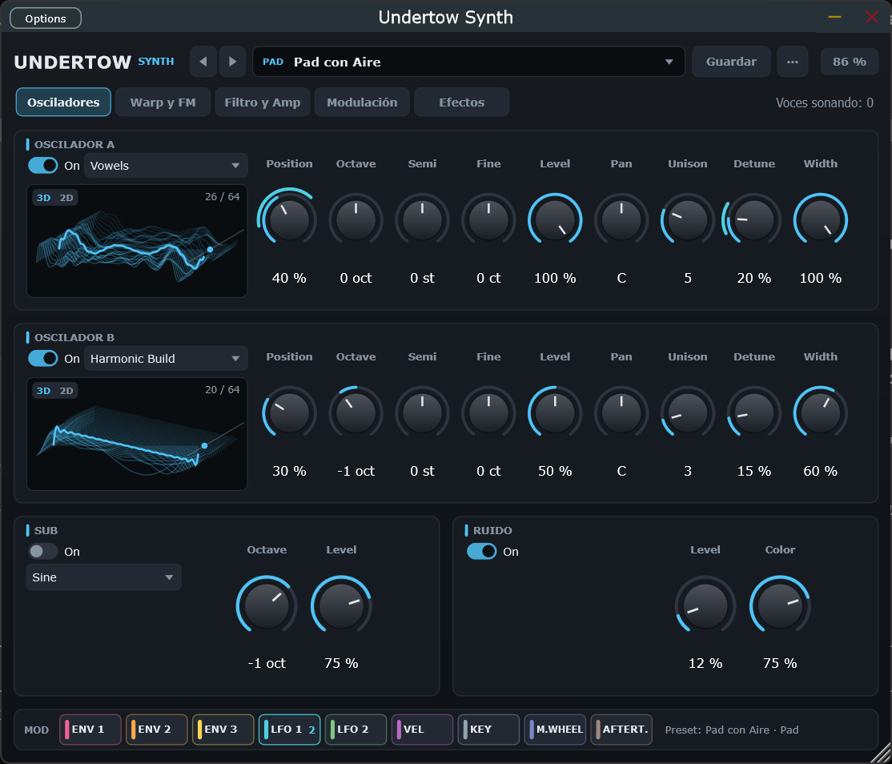
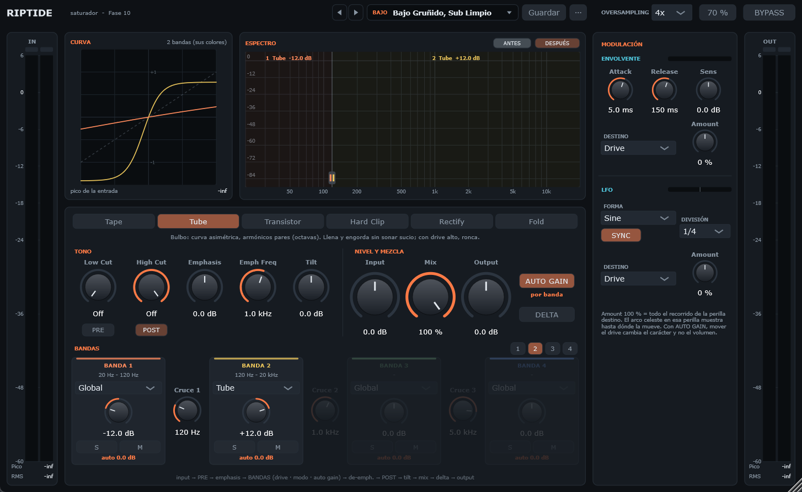

# Deepwater Audio

Suite de plugins de audio para Windows (VST3 y Standalone), escrita en C++20 con [JUCE](https://juce.com). Cada plugin
toma como referencia de calidad un estándar de la industria, pero con nombre, diseño y código propios.

Es también un proyecto de aprendizaje: cada plugin se construye por fases pequeñas, y cada fase deja explicado el DSP
que usa y un cuaderno (`APRENDIZAJE.md`) con ejercicios de escucha, recetas y vocabulario de diseño sonoro y mezcla.



## Plugins

| # | Plugin | Qué es | Referencia de nivel | Estado |
|---|--------|--------|---------------------|--------|
| 1 | [Undertow](plugins/undertow) | Sintetizador wavetable: FM, warp, unison, matriz de modulación, efectos, cuerda pulsada (Karplus-Strong) y 49 presets con notas | Serum 2, Vital | ✅ Terminado |
| 2 | [Riptide](plugins/riptide) | Saturador: 6 modos (cinta, bulbo, transistor, clip, rectificador, wavefold), tono PRE/POST, paralelo con auto gain, hasta 4 bandas, envolvente y LFO, 26 presets con notas | Decapitator, Saturn 2 | ✅ Terminado |
| 3 | [Ebb](plugins/ebb) | Ducker / modulador de volumen para sidechain: curvas sincronizadas al tempo, disparo por MIDI o por audio (para patrones irregulares como el dembow), editor de curvas y ducking solo en graves | Kickstart 2, LFOTool, ShaperBox (módulo de volumen) | ✅ Terminado |
| 4 | [Fathom](plugins/fathom) | EQ paramétrico de 24 bandas con analizador: todas las formas y pendientes, edición sobre el espectro, estéreo L/R/Mid/Side, EQ dinámico, fase lineal, dinámica espectral e igualación | FabFilter Pro-Q 4 | En curso (Fase 1) |
| 5 | Compresor | Estilos limpio y FET/1176 | FabFilter Pro-C 2, 1176 | Pendiente |
| 6 | Delay | Sync, ping-pong, filtros y modulación en el feedback | Valhalla Delay | Pendiente |
| 7 | Reverb | Algorítmica (FDN, difusión, modulación); modos vintage y espacial | Valhalla VintageVerb, Supermassive | Pendiente |

Cada plugin tiene su propio README con la guía de uso ([Undertow](plugins/undertow/README.md),
[Riptide](plugins/riptide/README.md)), su hoja de ruta (`CLAUDE.md`) y su cuaderno (`APRENDIZAJE.md`).



## Estructura

```
CMakeLists.txt     raíz: JUCE 9.0.2 (FetchContent, una sola vez) + librerías + plugins
libs/dsp/          deepwater::dsp, la librería DSP compartida (sin JUCE): oversampling halfband ×2–×16, filtro SVF
                   TPT/ZDF, crossovers Linkwitz-Riley, filtro de 1 polo y tilt, filtro DC, suavizado, línea de
                   retardo, SIMD, FFT, analizador de espectro, medidores, LFO, seguidor de envolvente y buzón audio → GUI.
                   Con tests
libs/presets/      deepwater::presets (con JUCE): formato XML de presets, biblioteca, barra, navegador y guardar
plugins/undertow/  sintetizador wavetable
plugins/riptide/   saturador
plugins/ebb/       ducker para sidechain
plugins/fathom/    EQ paramétrico con analizador
scripts/           null_test.py: compara dos renders para comprobar que un cambio no alteró el sonido
                   level_match.py: iguala la sonoridad (LUFS) de varias versiones para compararlas a oído o a ciegas
```

Cada plugin compila a su propio VST3/Standalone independiente y enlaza la librería compartida de forma estática.

## Compilar

Requisitos: Windows 10/11 de 64 bits, [Visual Studio 2022](https://visualstudio.microsoft.com/es/vs/community/)
(Community sirve) con el workload **"Desarrollo para el escritorio con C++"**, [CMake](https://cmake.org/download/)
3.22 o superior y Git. JUCE se descarga solo durante la configuración.

```bash
git clone https://github.com/EduardoCamposCasillas/deepwater-audio.git
cd deepwater-audio
cmake -B build -G "Visual Studio 17 2022" -A x64
cmake --build build --config Release                                  # toda la suite, con tests
cmake --build build --config Release --target UndertowSynth_VST3      # o solo un plugin
cmake --build build --config Release --target Riptide_VST3
cmake --build build --config Release --target Ebb_VST3
cmake --build build --config Release --target Fathom_VST3
```

Los plugins quedan en `build/plugins/<plugin>/<Target>_artefacts/Release/VST3` (y `Standalone`). Si `cmake` no se
reconoce, usa la ruta completa (`"C:\Program Files\CMake\bin\cmake.exe"`) o agrégalo al PATH.

### En FL Studio

1. **Options → Manage plugins → Plugin search paths**: agrega la carpeta `build\plugins` del repositorio y márcala
   como tipo **VST3** (si queda como VST2, FL no encuentra los plugins). FL busca en las subcarpetas, así que esa sola
   ruta sirve para todos los plugins de la suite.
2. Pulsa **Find installed plugins**.
3. Los instrumentos (Undertow) aparecen en el Channel Rack (**+**) y los efectos (Riptide, Ebb, Fathom) en las ranuras del Mixer,
   bajo el fabricante **Deepwater**.

### Tests

```bash
ctest --test-dir build -C Release --output-on-failure
```

Corre los tests de la librería compartida (`DeepwaterDspTests`) y los de cada plugin. La validación de cada plugin
se hace además con [pluginval](https://github.com/Tracktion/pluginval) en strictness 10, con 4 frecuencias de muestreo
y bloques de 1 a 4096 muestras.

## Licencia

[GNU AGPLv3](LICENSE). Los plugins usan [JUCE](https://juce.com), que se distribuye bajo AGPLv3 o bajo una licencia
comercial.
